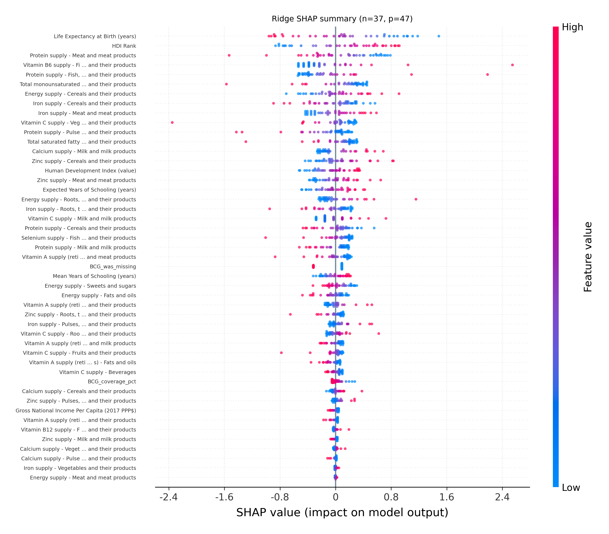
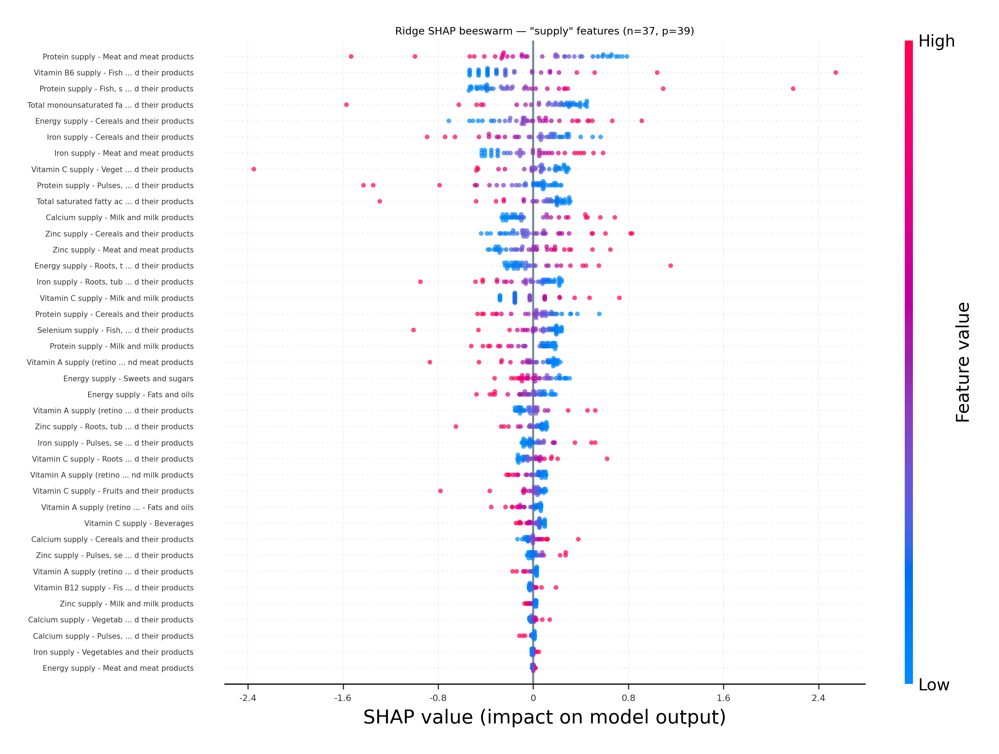

# Predicting Tuberculosis Incidence in 2022

## A Ridge Regression and SHAP Analysis — CIIT 2026

Research materials for **“Predicting Tuberculosis Incidence in 2022: A Ridge Regression and SHAP Analysis”** (Paper ID 31). This project examines how country-level nutrition supply, human development, and BCG vaccination coverage relate to tuberculosis incidence in 2022. It combines public datasets, fits a regularized regression model, and uses SHAP to explain its predictions.

**Authors:** Mila Jovanoska, Andrej Ristovski, Anika Ristevska, and Slobodan Kalajdziski.  
**Affiliation:** Faculty of Computer Science and Engineering (FINKI), Ss. Cyril and Methodius University (UKIM), Skopje, North Macedonia.

This repository preserves the supplied paper and supplementary analysis. It is a research archive, not a clinical prediction service. The analysis concerns countries and a single reference year; it does not estimate an individual person's risk or establish causal effects.

## Start here

- [Read the paper (PDF)](paper/CIIT2026_Paper31.pdf)
- [Download the editable paper (Word)](paper/CIIT2026_Paper31.docx)
- [Explore the analysis notebook](tuberculosis_case_prediction_from_nutrition_and_demographic_factors_2022.ipynb)
- [View the integrated dataset](datasets/final_dataset/final_dataset_2022_who_faostat_hdi_bcg.csv)
- [Review reproducibility notes](#reproducibility-and-known-limitations)

## Research question

How well can nutritional supply, development indicators, and vaccination coverage predict differences in TB incidence across countries, and which features contribute most to the Ridge model's predictions?

The target is **TB incidence per 100,000 population in 2022**. The integrated dataset contains **183 countries and 49 columns**: a country identifier, 39 nutrition features, six human-development variables, two BCG-related variables, and the TB target. The country identifier is retained for reference and excluded from modeling.

## Repository structure

| Location | Contents |
|---|---|
| `tuberculosis_case_prediction_from_nutrition_and_demographic_factors_2022.ipynb` | Original analysis notebook, including saved outputs |
| `datasets/original_datasets/` | Supplied source spreadsheets and vaccination CSV |
| `datasets/clean_datasets/` | Cleaned and reshaped intermediate data |
| `datasets/final_dataset/` | Integrated country-level dataset |
| `images/` | Supplied TB illustrations and SHAP figures |
| `paper/` | PDF and editable Word versions of the paper |
| `requirements.txt` | Dependencies inferred from the notebook; versions are not pinned |
| `source-manifest.json` | SHA-256 checksums of the published original research files |

The notebook remains at the repository root so its relative `datasets/` and `images/` paths are preserved. The automatic `.ipynb_checkpoints` backup is excluded. Both copies of the supplied vaccination CSV are retained to preserve the original folder structure.

## Data and workflow

The supplied materials combine FAOSTAT food and nutrient supply indicators, WHO TB incidence data, UNDP human-development indicators, and BCG vaccination coverage. See the paper's references and the notebook's source discussion for attribution. Source filenames are preserved, including `worldbank_dataset.xlsx`; a filename alone should not be taken as verified provenance.

The notebook covers:

1. Exploration, cleaning, and harmonization of country names.
2. Selection and reshaping of nutrition indicators into country-level features.
3. Integration with TB incidence, development indicators, and vaccination coverage.
4. Iterative imputation of missing predictor values and a BCG missingness indicator.
5. An 80/20 shuffled train/test split with random seed 42.
6. Standardization and Ridge regression in a scikit-learn pipeline.
7. Five-fold shuffled cross-validation over 13 alpha values from `0.001` to `1000`, using negative MAE as the tuning score.
8. Held-out evaluation and SHAP explanations of model predictions.

The code transforms the target with `numpy.log1p(y)`. Its evaluation clips negative predicted transformed values to zero before computing test metrics.

## Results reported in the paper

The paper reports the following held-out results for Ridge regression with **alpha ≈ 3.16**:

| Metric | Reported value |
|---|---:|
| RMSE (transformed target scale) | 0.86 |
| R² (transformed target scale) | 0.69 |
| MAE (transformed target scale) | 0.69 |

These are **paper-reported values**, not results from a new execution of this repository. Errors on the transformed scale should not be interpreted as errors in cases per 100,000 population.

The paper also compares Ridge with Lasso, Elastic Net, Gradient Boosting, and Random Forest. The supplied notebook primarily implements the Ridge and SHAP workflow; the complete benchmarking code for the paper's comparison table is not included.

## Interpretation and figures

The paper identifies development-related indicators and selected nutrition supply features as important contributors to model predictions. SHAP values describe the fitted model's behavior; they do not show that changing a feature would cause a change in TB incidence. Correlated predictors can also complicate attribution.



*Supplied SHAP summary for the integrated Ridge analysis.*



*Supplied SHAP view restricted to nutrition supply features. This is a feature subset of the explanation, not evidence of a separately trained nutrition-only model.*

## Run locally

Clone the repository and start Jupyter from its root directory:

```bash
git clone https://github.com/MilaJovanoska/tb-incidence-ridge-shap-ciit2026.git
cd tb-incidence-ridge-shap-ciit2026
python -m venv .venv
```

Activate the environment:

```bash
# macOS / Linux
source .venv/bin/activate

# Windows PowerShell
.venv\Scripts\Activate.ps1
```

Install dependencies and launch Jupyter:

```bash
python -m pip install -r requirements.txt
python -m jupyter lab
```

Open `tuberculosis_case_prediction_from_nutrition_and_demographic_factors_2022.ipynb`. Inspect its cells before running them sequentially. Keep the supplied directory structure intact. The notebook includes exploratory output and uses both raw and already cleaned data; the integrated CSV is also provided for inspecting the final modeling input.

## Reproducibility and known limitations

- **No fresh execution is claimed.** The original notebook and its saved outputs are preserved. Dependency versions are inferred rather than recovered from a tested environment.
- **Target-transform discrepancy:** the paper writes `ln(y)`, whereas the notebook uses `ln(1 + y)`. This distinction matters when interpreting or reproducing the reported metrics.
- **Tuning criterion:** the notebook selects alpha using cross-validation MAE. The paper emphasizes RMSE for comparing models; these are different steps and should not be conflated.
- **Imputation precedes the split:** the supplied notebook fits iterative imputation on the integrated predictor data before train/test separation. This allows held-out predictor information to affect preprocessing. A stricter validation workflow would fit imputation inside the training/CV pipeline and evaluate the revised model anew.
- **Comparison models:** the supplied notebook does not contain the full model-benchmarking workflow described in the paper.
- **Data provenance:** the notebook and paper differ in their wording of some source editions. Exact download versions and access dates should be reconciled before claiming a fully reproducible source-to-results release.
- **Scope:** the sample is small and ecological, with one observation per country for one year. Associations cannot establish causality or be transferred directly to individual patients. Temporal and external validation remain future work.

These notes document the supplied research archive without altering the paper, notebook, or reported findings.

## Citation and reuse

Please credit all four authors and cite the paper title when referring to this work:

> Mila Jovanoska, Andrej Ristovski, Anika Ristevska, and Slobodan Kalajdziski. “Predicting Tuberculosis Incidence in 2022: A Ridge Regression and SHAP Analysis.” CIIT 2026, Paper ID 31.

No DOI or final proceedings citation has been added because none was verified from the supplied materials. No blanket software or document license is assigned in this repository. Third-party datasets and illustrations retain their original ownership and applicable terms; inclusion here does not grant additional reuse rights.
